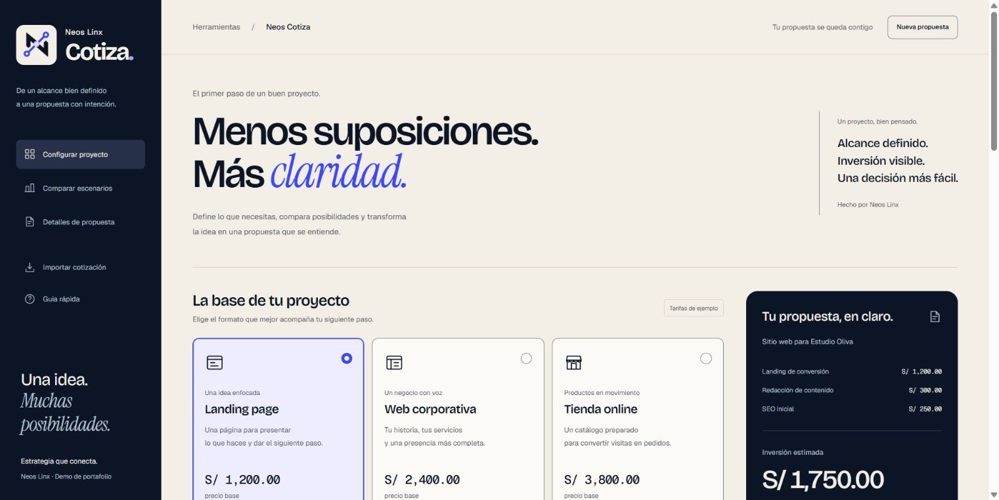

# Neos Cotiza

**Del alcance al presupuesto, con cada importe a la vista.**

Una demo de portafolio de **Neos Linx** para configurar un proyecto web, comparar alternativas y preparar una propuesta. HTML, CSS y JavaScript modular, sin paquetes de npm ni servicios externos. Versión **1.1.1**.



[Ver captura móvil](docs/captura-mobile.jpg).

[Ver propuesta de ejemplo en PDF](examples/propuesta-ejemplo.pdf) · [Notas del ejemplo](examples/README.md).

## La experiencia

- Configura servicios, extras, páginas adicionales, prioridad, descuento, impuesto opcional y adelanto.
- Compara tres escenarios con los mismos extras y condiciones: importe, diferencia y plazo inicial. Aplica otra opción sin volver a empezar.
- Revisa el desglose y abre una propuesta preparada para imprimir desde el navegador.
- Descarga e importa JSON; conserva un borrador local solo si activas esa opción.
- Identidad de Neos Linx con su isotipo real y cuatro familias tipográficas alojadas localmente.

Los negocios de ejemplo son ficticios y los precios son ilustrativos. La demo no constituye una oferta contractual ni determina cuándo corresponde aplicar un impuesto.

## Ejecutar

Necesitas **Node.js 22 o posterior**. No hace falta `npm install`.

```sh
npm start
```

Abre [http://127.0.0.1:4173](http://127.0.0.1:4173). Usa `Ctrl+C` para detenerlo. Los módulos ES requieren HTTP; abre la app mediante el servidor local.

```sh
npm run check
npm test
npm run build
npm run preview
```

`check` revisa sintaxis, recursos locales, CSP y patrones limitados de secretos. Las pruebas usan `node --test`. El build prepara `dist/`; `preview` sirve ese resultado en el mismo puerto. Detén antes el servidor que ya lo esté usando. El workflow de GitHub comprueba el proyecto y no despliega.

## Crear paquetes

```sh
npm run package
```

Construye la app y genera en `release/`:

- `neos-cotiza-v1.1.1-github.zip`: fuentes, scripts, pruebas, documentación y ejemplo ficticio.
- `neos-cotiza-v1.1.1-web.zip`: únicamente los archivos públicos del build.
- `SHA256SUMS.txt`: sumas de ambos ZIP.

El empaquetador usa APIs nativas de Node.js, valida el listado, enlaces simbólicos, correspondencia con `dist/` y CRC. Los ZIP son reproducibles con la misma versión de Node y zlib. `release/` está ignorado por Git; generar paquetes no los publica.

## Imprimir la propuesta

En Chrome, usa **A4**, **escala 100 %** y desactiva los encabezados y pies automáticos del navegador. La propuesta incluye pie de Neos Linx y numeración «Página n de m». Se verificaron PDF de una y dos páginas mediante Chrome headless local. No se probaron el diálogo nativo, impresoras físicas ni otros navegadores.

## Dónde mirar

| Quieres revisar o cambiar… | Empieza por… |
| --- | --- |
| Servicios, precios y plazos | `src/catalog.js` |
| Reglas y cálculos en céntimos | `src/quote.js` |
| Colores, tipografías y estilos | `styles/tokens.css` y los módulos de `styles/` |
| Formulario, resumen, propuesta y comparación | `src/ui/` |
| Eventos y flujo de la aplicación | `src/app.js` |
| Archivos que se sirven y publican | `scripts/project-files.mjs` |

La guía de [personalización](docs/PERSONALIZACION.md) explica qué archivos cambiar juntos. Consulta también la [arquitectura](docs/ARQUITECTURA.md), la [procedencia de los recursos](docs/RECURSOS.md) y [cómo contribuir](CONTRIBUTING.md).

## Alcance y privacidad

Es una aplicación estática: no tiene backend de datos, cuentas, API externas ni pagos. Node.js solo sirve los archivos en `127.0.0.1` durante el desarrollo. La cotización se procesa en el navegador; el alojamiento futuro podrá registrar las peticiones de archivos según su configuración.

El borrador opcional utiliza `localStorage`, clave `neos-cotiza:draft:v1`, sin cifrado de la aplicación. Los JSON y PDF que guardes pueden incluir los textos introducidos. Usa datos ficticios para las demostraciones. [Seguridad y privacidad](SECURITY.md).

El estado de las pruebas y las revisiones pendientes está en [Verificación de la versión 1.1.1](docs/VERIFICACION.md). La [revisión de seguridad de la versión 1.0.0](docs/SEGURIDAD-PREPUBLICACION.md) se conserva como antecedente histórico.

No se ha publicado esta versión ni se ha elegido la cuenta, el repositorio o el alojamiento de destino. Los pasos de publicación están documentados para cuando se defina ese destino.
